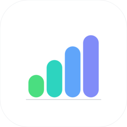
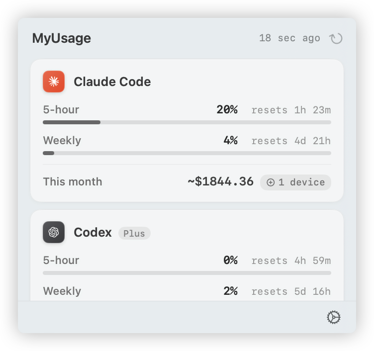
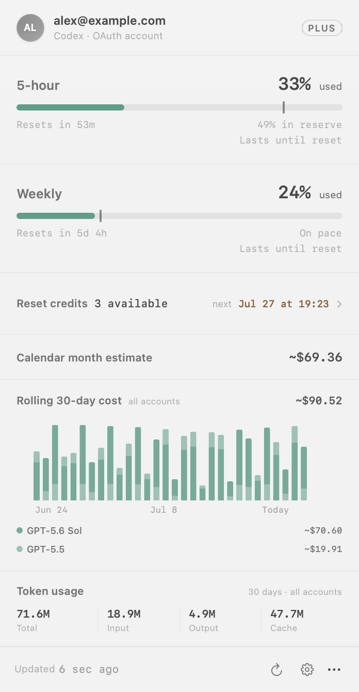

<p align="center">
  
</p>

<h1 align="center">MyUsage</h1>

<p align="center">
  One menu bar for every AI coding tool — across every Mac you use.
</p>

<p align="center">
  <a href="https://github.com/zchan0/MyUsage/releases/latest"></a>
  
  
  <a href="https://zchan0.github.io/MyUsage/"></a>
  <a href="README.zh-CN.md"></a>
</p>

<p align="center">
  <strong>Project site:</strong> <a href="https://zchan0.github.io/MyUsage/">zchan0.github.io/MyUsage</a> — landing, install guide, multi-device sync deep dive, blog.
</p>

<p align="center">
  
  
</p>

## Why MyUsage

If you use **Claude Code, Codex, Cursor, or Antigravity** — and especially if you use them across **more than one Mac** — the official UIs only show what's happening on the device you're sitting at. You hit a weekly limit on Friday afternoon because your laptop has been chewing through tokens all morning while your desktop's "remaining" number lied to you.

MyUsage fixes this with a small native menu bar app that:

- Talks to all four providers and shows them in one popover, so you don't have to flip between four UIs.
- **Aggregates across every Mac you own** by writing tiny snapshots into a folder you already sync (iCloud Drive, Syncthing, Dropbox, an NFS mount — your call). No MyUsage backend exists; the sync transport is yours.
- Tells you whether your current pace leaves capacity in reserve or creates a deficit, then turns that into an actionable outcome: `Runs out in 3h` or `Lasts until reset`.

It's free, MIT, no telemetry, and pure Swift / SwiftUI with zero third-party dependencies.

## Highlights

- **Multi-device aggregation, BYO sync transport.** Each Mac drops a per-device JSONL snapshot into `<sync-folder>/devices/<id>/`. Use iCloud, Syncthing, Dropbox, NAS, or anything else that keeps a folder in sync. The Devices tab in Settings lets you forget retired peers.
- **Built-in tools and custom gateways in one popover** — Claude Code, Codex, Cursor, Antigravity, plus named LiteLLM gateway instances. Reorder and enable/disable each instance in Settings.
- **Pressure-ordered Overview + clean provider detail.** Overview promotes the limit that needs attention and keeps every provider comparable on one reading axis. Open a provider for account identity, capacity, reset credits, costs, and tokens in a compact clean-glass layout.
- **Actionable pace, in familiar units.** Every rolling limit compares usage with its pace marker as `N% in reserve`, `N% in deficit`, or `On pace`. Once the projection is reliable, MyUsage adds `Runs out in…` or `Lasts until reset`. A conservative early-window fallback catches obvious acceleration without letting one large prompt create a false alarm.
- **30-day model costs with hover inspection.** Claude and Codex get a stacked daily chart plus a stable vertical model-cost breakdown. By default it shows each model's rolling cost; hover a day to see that day's total and per-model costs without the legend changing order.
- **Synced token totals.** Claude and Codex Detail shows 30-day Total / Input / Output / Cache tokens across all ledger accounts and synced Macs, separately from the cost chart.
- **Codex reset-credit inventory.** See the authoritative available count and nearest expiry in one row, then expand it for every reported reset-credit expiry.
- **Claude quota from official statusline data.** Explicitly connect in Settings → Providers. MyUsage reads private local 5-hour / 7-day snapshots without accessing Claude credentials, querying OAuth usage/profile APIs, or launching Claude Code.
- **Limit-pressure notifications.** Native macOS notifications fire the moment any tracked limit crosses your warn / crit threshold (default 80% / 95%, both tunable). Idempotent — same percent across two refreshes never double-fires.
- **In-app update channel.** On launch, MyUsage checks GitHub Releases and shows a banner when a newer tag is available. The Settings → About banner can download the next release and reveal it in Finder one drag away from /Applications.
- **Privacy-respecting device identity.** Multi-device sync uses a salted SHA-256 of `IOPlatformUUID` as the device ID; the raw hardware UUID never leaves the process. Cached in UserDefaults so reinstalling doesn't create a duplicate device.
- **Zero third-party dependencies.** Built only with SwiftUI, SQLite3, Security.framework, Foundation. No Electron, no Sparkle, no analytics SDK.

## Supported Providers

| Provider | Data Source | What You See |
| --- | --- | --- |
| Claude Code | Official statusline → private local snapshot; local JSONL for costs/tokens | Optional 5h + weekly limits with local receipt time · 30-day model cost + token totals · monthly estimate; email/plan not provided |
| Codex | OAuth API (`~/.codex/auth.json` / Keychain) | 5h + weekly limits · reserve/deficit outcome · reset-credit inventory · 30-day model cost + token totals · monthly cost |
| Cursor | Local SQLite + Connect RPC (`state.vscdb`) | Included quota + on-demand budget bars · billing-cycle countdown |
| Antigravity | Local language server process probe | Per-model quota bars · IDE running indicator |
| LiteLLM gateway | Configured host + API key; read-only usage APIs | User/key budget and spend · optional UTC month-to-date cost, model and token history |

## Requirements

- macOS 14+ (Sonoma)
- A supported tool installed and signed in, or a configured LiteLLM gateway

## Install

Download the latest `MyUsage-<version>.zip` from [GitHub Releases](https://github.com/zchan0/MyUsage/releases), unzip it, then move `MyUsage.app` to `/Applications`.

MyUsage is ad-hoc signed (no paid Apple Developer certificate), so Gatekeeper will warn on first launch:

- Right-click `MyUsage.app` -> `Open` -> `Open` once.
- Or run:

```bash
xattr -cr /Applications/MyUsage.app && open /Applications/MyUsage.app
```

Each release includes a `.sha256` file for checksum verification.

## Quick Usage

1. Launch MyUsage from `/Applications`.
2. Click the menu bar icon for the pressure-ordered Overview, then open a provider for full Detail.
3. Hover a cost-chart day to inspect its total and per-model costs; use the refresh button for manual sync.
4. Open Settings for:
   - `General`: refresh interval, menu bar tracking, estimated cost toggle, sync folder, launch at login
   - `Providers`: reorder, toggle, and add/edit named LiteLLM gateways
   - `Devices`: inspect aggregated monthly cost by device and forget stale peers
   - `About`: app version and project link

## Claude Code statusline integration

Open **Settings → Providers → Claude Code statusline → Enable Integration**. This is opt-in: starting MyUsage or clicking Refresh never edits Claude settings or launches Claude Code. The setting uses `CLAUDE_CONFIG_DIR/settings.json` when that environment variable is present in MyUsage, otherwise `~/.claude/settings.json`. Project/managed settings can override it; verify the effective statusline in a normal Claude Code session.

The wrapper sends the official stdin to MyUsage's native `--claude-statusline` collector, then passes the same bytes to the original command. It preserves the original stdout, stderr, exit status, and other settings. A collector error is silent and does not prevent the original command from running. No Python, jq, helper download, or third-party dependency is needed. MyUsage's executable must stay at the location used when enabling; disable/re-enable before moving the app.

**Disable Integration** restores only the original command and retains edits to other settings. Enabling/disabling is idempotent. If the user changes or removes the installed command, MyUsage refuses to overwrite that change. Restore the installed wrapper before disabling, or remove the wrapper manually. The installation record contains only the original and installed commands, not a backup of the full settings file. Existing statusline scripts remain unchanged: if they read tokens or use network APIs, those are their own behaviors and continue until the user changes that script.

Snapshots live only in `~/Library/Application Support/MyUsage/ClaudeStatusline/snapshots/`. Directories are `0700`, files and locks `0600`; the directory is excluded from system backup and is not sent to the sync folder. Each session has a separate file, serialized with a process lock and replaced atomically. A snapshot contains only schema version, local receipt time, session ID, Claude Code version, and the two quota windows. The app selects one latest receipt; it never sums sessions, combines their windows, or infers account identity from a session ID. Different signed-in accounts cannot be distinguished by this source.

The official fields are `rate_limits.five_hour` and `rate_limits.seven_day`, each with `used_percentage` (0–100) and `resets_at` (Unix seconds). Each window can be absent. Eligible subscriptions report these fields only after the session's first API response. See [Claude Code statusline documentation](https://code.claude.com/docs/en/statusline#rate-limit-usage).

The UI distinguishes not connected, waiting for quota, local snapshot, old snapshot, and damaged data. Overview and Claude Detail show a separate snapshot receipt date/time and relative age. Missing windows remain unknown; expired windows disappear from current limits, even with automatic refresh disabled. Receipts older than 15 minutes are labeled old. Only valid, enabled Claude data can generate new quota notifications; old, disconnected, waiting, or damaged data is excluded. **Local receipt time is not the server sample time**: repeated statusline events may carry unchanged quota. Automatic/manual refresh only rereads local files at the configured interval; it cannot obtain new quota. **When Claude Code is not running or provides no new data, MyUsage can only show an old snapshot with its receipt time.** No integration can promise that an account will never be restricted or banned.

Local JSONL cost and token statistics remain separate estimates and ledger totals; they never substitute for subscription quota. Statusline does not supply email, plan, per-model subscription caps, or extra-usage billing, so these remain unprovided. New Claude cost days use the ledger's existing `default` bucket. An existing unique daily storage key is retained to prevent duplicate counting; it is never used as current account identity. Days with ambiguous legacy attribution remain unchanged and display a cost-history notice. The ledger schema and sync format are unchanged. The old OAuth cache and credential copies are never read during migration. Existing legacy Keychain entries are left untouched; Claude Code and other providers' credentials are not modified.

## LiteLLM gateways

Open **Settings → Providers → Add Gateway…**. Enter a name, your gateway's HTTPS base URL, and API key, then **Check Usage Access** and **Add Provider**. Vendor is currently fixed to LiteLLM. Multiple connections to the same vendor remain independent; keys are stored in this Mac's Keychain. Changing the host requires re-entering a key.

Saved keys survive app restarts. After an update or local rebuild, macOS may require Keychain authorization again because MyUsage is ad-hoc signed. Click **Refresh**, or leave the key field empty in **Edit Gateway → Check Usage Access**, and choose **Always Allow** in the system dialog to retain access for that build. Background refreshes never prompt; denied access preserves the saved key and shows an authorization message.

The check reads your own `/key/info`, then `/user/info?user_id=…` when your identity is known. If the key cannot identify a user, an optional User ID field appears. If both scopes are readable, choose **My account** (all linked keys) or **This API key**. The check also probes one short page of account history; history permission failures do not discard a readable budget. Unverified settings can be saved for later.

Account history comes from `/user/daily/activity`, from the first day of the current month through today in UTC. Availability depends on the deployment and key permissions. Key-only scope currently shows its summary without borrowing account history. Budget-period spend and monthly logged usage can differ. Missing values stay unknown; incomplete pagination/model breakdowns are labeled. Gateway-reported costs are separate from local estimates and multi-device sync, and are not summed across instances.

Model names and per-model metrics come from `breakdown.model_groups`, using the aliases visible in clients such as Codex and Claude Code. If model groups are missing, model details remain unavailable; deployment-level `models` are not used as a fallback because their names and request coverage can differ.

## Build from Source

```bash
# Release build + app bundle
./Scripts/package_app.sh

# Or build release binary only
swift build -c release

# Open packaged app
open MyUsage.app
```

Open in Xcode (SwiftPM workspace):

```bash
open .swiftpm/xcode/package.xcworkspace
```

## Architecture Notes

- `UsageManager` drives refresh orchestration and UI state.
- Provider adapters normalize external/local data into a shared snapshot model.
- Device sync writes each Mac's daily cost/model/token ledger into its own subfolder in the selected sync directory.

More details: [docs/architecture.md](docs/architecture.md)

## Privacy and Data

- Claude quota uses only opt-in local statusline snapshots; its costs/tokens use local JSONL. Other provider integrations read their required local credentials/state and Keychain entries.
- Network requests are sent only to provider endpoints required for usage retrieval.
- Multi-device sync uses a user-selected local/shared folder; MyUsage does not run its own cloud backend.

## Roadmap

Possible directions, not commitments. Open an issue if any of these would
make MyUsage materially more useful for you:

- **Notarized + signed releases** — so the .app opens without the Gatekeeper
  warning on a fresh Mac. Blocked on an Apple Developer account.
- **More providers as APIs become available.** GitHub Copilot is the most
  requested but doesn't currently expose per-user usage to individual
  subscribers; we'll add it the moment that changes.
- **iOS / iPadOS companion** for at-a-glance checking when you're not at
  a Mac. Lower priority than core macOS feature work.

## License

MIT
