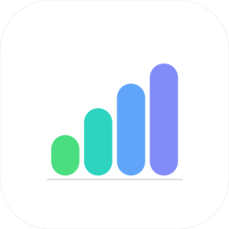
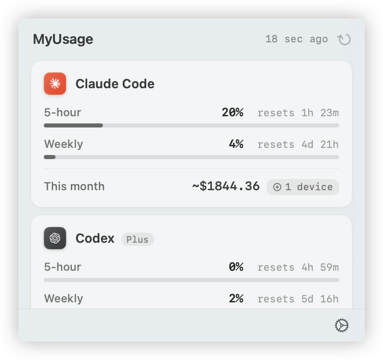
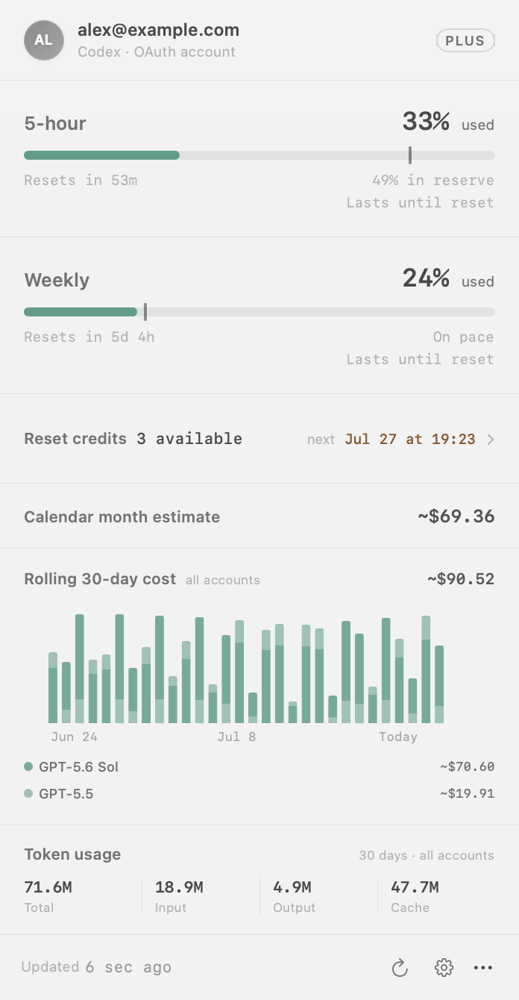

<p align="center">
  
</p>

<h1 align="center">MyUsage（中文说明）</h1>

<p align="center">
  一个菜单栏，统揽你所有 AI 编程工具——并跨所有 Mac 聚合。
</p>

<p align="center">
  <a href="https://github.com/zchan0/MyUsage/releases/latest"></a>
  
  
  <a href="https://zchan0.github.io/MyUsage/"></a>
  <a href="README.md"></a>
</p>

<p align="center">
  <strong>项目站点：</strong><a href="https://zchan0.github.io/MyUsage/">zchan0.github.io/MyUsage</a>——介绍页、安装指南、多设备同步深度文档、blog。
</p>

<p align="center">
  
  
</p>

## 为什么需要 MyUsage

如果你用 **Claude Code、Codex、Cursor 或 Antigravity**——尤其是同时用**多台 Mac**——官方 UI 只显示当前这台机器上的状态。结果就是：周五下午突然命中 weekly limit，因为笔记本一上午都在烧 token，桌面机器上显示的"剩余额度"完全是假的。

MyUsage 是一个原生的 macOS 菜单栏小应用，解决方式是：

- 同时对接四个 provider，一个 popover 看完，不用在四个 UI 之间切。
- **跨所有 Mac 聚合**——每台机器把一个 JSONL 快照写到你**已经在同步**的目录里（iCloud Drive、Syncthing、Dropbox、NFS 挂载点都行），完全不依赖 MyUsage 的服务器（也不存在这种东西）。
- 把消耗速度说成人能直接行动的信息：当前比 pace 多出多少 `deficit`、还留有多少 `reserve`，以及最终会 `Runs out in 3h` 还是 `Lasts until reset`。

免费、MIT、不发任何 telemetry，纯 Swift / SwiftUI 实现，零第三方依赖。

## 特色能力

- **跨设备聚合 + 自带同步通道**：每台 Mac 把 per-device 的 JSONL 快照写进 `<sync-folder>/devices/<id>/`。同步通道随你选——iCloud、Syncthing、Dropbox、NAS 都可以。Settings → Devices 可以"忘记"已退役的旧设备。
- **四个 provider 一个弹层**：Claude Code、Codex、Cursor、Antigravity。Settings 里可以拖拽排序、启用/禁用。
- **Provider 胶囊栏**：弹窗直接打开一个 provider。用胶囊栏切换，琥珀色圆点提示其他 provider 的额度风险。
- **额度与 pace**：三角标记显示窗口已过去的比例。额度卡会显示余量、超出 pace 的幅度，以及可用的预计耗尽时间。
- **本地模型用量**：Claude 和 Codex 支持在今天和近 30 天之间切换。悬停柱形查看该时段的 tokens 和缓存命中率。Claude 也显示本地日志上报的金额。
- **Reset credits**：数据源上报重置额度时，Claude 和 Codex 会显示可用次数和最近过期时间。展开查看每份额度。
- **Claude 官方 statusline 额度**：在 Settings → Providers 明确启用接入。MyUsage 只读本机 5 小时 / 7 天快照，不读 Claude OAuth 凭据，不请求用量/资料接口，也不启动 Claude Code。
- **Limit 压力通知**：任意 limit 跨过 warn / crit 阈值（默认 80% / 95%，可调）会立即弹 macOS 系统通知。带幂等：同一档不会重复弹；用量回落后状态自动 reset，下次再升能再触发。
- **应用内升级**：启动时检查 GitHub Releases，发现新版本时菜单栏图标和 Settings → About 都会有提示。banner 上的 Download 按钮可以一键下载新版的 .zip 并在 Finder 里高亮，离"拖到 /Applications"只差一拖。
- **隐私：硬件衍生的设备 ID**：跨设备同步用的设备 ID 是 `IOPlatformUUID` 加盐后 SHA-256 的结果，原始硬件 ID 永远不出本进程。`UserDefaults` 仅作缓存，重装也不会产生重复设备。
- **零第三方依赖**：只用 SwiftUI、SQLite3、Security.framework、Foundation。无 Electron、无 Sparkle、无 analytics SDK。

## 安装

1. 从 [Releases](https://github.com/zchan0/MyUsage/releases) 下载 `MyUsage-<version>.zip`
2. 解压后将 `MyUsage.app` 拖到 `/Applications`
3. 首次启动若出现 Gatekeeper 提示，可右键 `Open` 一次，或执行：

```bash
xattr -cr /Applications/MyUsage.app && open /Applications/MyUsage.app
```

每个 release 都会附带 `.sha256` 文件用于校验包完整性。

## 使用入口

- 点击菜单栏图标打开 provider。启用多个 provider 时，用胶囊栏切换。
- 点刷新按钮手动拉取最新数据。
- 在 Settings 中配置：
  - `General`：刷新频率、菜单栏追踪、同步目录、开机启动
  - `Providers`：provider 顺序、启用状态，以及 LiteLLM 网关的新增和编辑
  - `Devices`：查看设备聚合成本、忘记旧设备
  - `About`：版本与项目链接

## Claude Code statusline 接入

在 **Settings → Providers → Statusline Integrations → Claude Code → Connect** 启用。启动 MyUsage 和刷新均不会自动改配置，也不会安装、登录或启动 Claude Code。MyUsage 有 `CLAUDE_CONFIG_DIR` 环境变量时使用该目录的 `settings.json`，否则使用 `~/.claude/settings.json`。项目或受管配置可能覆盖该设置，需在正常会话中验收实际生效的命令。

包装命令先把官方 stdin 交给 MyUsage 原生 `--claude-statusline` 采集入口，再把同一份字节交给原命令。原 stdout、stderr、退出码和其他配置字段均保留。桥接失败不影响原命令。无需 Python、jq 或额外依赖。采集入口绑定启用时的 MyUsage 路径；移动应用后在设置中点 **Reconnect** 即可更新路径。

**Disconnect** 只恢复原命令，保留其他设置的新改动。重复启用/撤销幂等。若用户后来修改或移除了命令，MyUsage 拒绝用旧命令覆盖新配置，并提供 **Reveal** / **Reset**（仅清除 MyUsage 本地记录而不改动 `settings.json`）。接入记录只含原命令与包装命令，不备份整份配置。已有 statusline 脚本保持原样；若它自己读 token 或请求网络，这些行为仍由旧脚本执行，不属于新桥接。

快照仅保存到 `~/Library/Application Support/MyUsage/ClaudeStatusline/snapshots/`。目录权限 `0700`，快照和锁文件权限 `0600`。目录排除系统备份，不进入同步目录。各 session 独立文件，加锁后原子替换。内容仅含 schema 版本、本地接收时间、session ID、Claude Code 版本和两个额度窗口。不保存完整 stdin、token、项目路径或会话内容。读取时只选最新一份，不累加会话，不拼接窗口，也不从 session ID 推断账号。该来源无法区分不同登录账号。

[官方字段](https://code.claude.com/docs/en/statusline#rate-limit-usage)为 `rate_limits.five_hour` / `rate_limits.seven_day` 下的 `used_percentage`（0～100）和 `resets_at`（Unix 秒）。各窗口可独立缺失。适用订阅在会话收到首次 API 响应后才提供额度。

界面区分未接入、等待额度、本地快照、旧快照和损坏数据。Claude 额度卡在账户旁显示数据状态图标。悬停可查看来源和接收时间。底栏显示 MyUsage 最近一次本地刷新时间，与额度接收时间独立。接入说明和接收时间保留在 Settings → Providers。缺失窗口保持未知，重置时间已过的窗口不再作为当前额度，即使关闭自动刷新也会过期。接收超过 15 分钟标记为旧快照。只有有效且启用的 Claude 数据才会生成新额度通知；旧数据、断开接入、等待数据和损坏状态均排除。**本地接收时间不等于服务端采样时间**；重复 statusline 事件可能携带相同额度。自动/手动刷新只按设置的周期重读本地文件，不能获得新额度。**Claude Code 未运行或没有新数据时，MyUsage 只能展示带时间标记的旧快照。** 此改造不能保证账号不被限制或封禁。

账号标题可读取 Claude Code 本地 `.claude.json` 资料缓存中的邮箱和已识别套餐（`oauthAccount.emailAddress` / `organizationType`）。默认文件为 `~/.claude.json`；设置 `CLAUDE_CONFIG_DIR` 后使用该目录下的 `.claude.json`。套餐标签只显示套餐名称；悬停邮箱可看账号缓存来源和已有的缓存时间。资料可能过期，也无法确认某份快照属于该账号。它仅用于展示，不写入快照、账本账号键或同步文件。字段缺失或无法识别时保持未知，不通过 CLI、凭据或资料接口补查。

本地 JSONL 成本、token 统计和已有同步账本保留。成本估算不替代订阅额度。分模型订阅额度及额外用量账单仍显示未提供。新的 Claude 成本日期使用账本原有 `default` 桶。已有日期保留唯一存储键，避免重复计数；该键不作为当前账号身份。旧日期归属有歧义时保留记录，并提示成本历史未更新。账本 schema 与同步格式不变。迁移不读取旧 OAuth 用量缓存或凭据副本，也不清理既有 Keychain 项。Claude Code 及其他 provider 的凭据保持原样。

## Antigravity CLI statusline 接入

在 **Settings → Providers → Statusline Integrations → Antigravity CLI → Connect** 启用。该接入为可选回退方案，适用于本地 language server 额度接口不可用的场景（例如 Antigravity 2.34+ 使用私有 stdin token，或仅使用 `agy` CLI）。启动 MyUsage 或点击刷新不会自动修改配置，也不会启动 `agy`。配置文件优先读取 `ANTIGRAVITY_CLI_CONFIG_DIR/settings.json`，否则使用 `~/.gemini/antigravity-cli/settings.json`。启用后需新开或重启 `agy` 会话以加载新配置。

包装命令先把 `statusLine` stdin 交给 MyUsage 原生 `--antigravity-statusline` 采集入口，再把同一份字节传给原有命令，完整保留原 stdout、stderr、退出码与其他字段。若原本没有自定义命令，MyUsage 会添加 `stack_with_default: true` 以保留 `agy` 内置状态栏，并在断开接入时移除该新增字段。**Disconnect** 仅恢复原命令及原本的 `enabled` / `type` 状态；若你在外部修改了命令，MyUsage 会拒绝覆盖你的改动并提供 **Reveal** / **Reset**。

快照仅保存在 `~/Library/Application Support/MyUsage/AntigravityStatusline/snapshots/`（目录 `0700`、快照与锁文件 `0600`，排除系统备份且不进入同步目录），只持久化白名单字段（schema 版本、本地接收时间、会话 ID、CLI 版本、套餐、邮箱与额度桶）。当存在带 token 的本地 language server 进程时仍优先使用实时 RPC；否则回退展示最新本地 statusline 快照，并沿用 15 分钟旧快照标记、读取时自动隐藏过期窗口、状态图标与仅有效快照触发通知等规则。

## LiteLLM 网关

在 **Settings → Providers → Add Gateway…** 填写名称、HTTPS host 和 API key，点击 **Check Usage Access** 检查后添加。当前 Vendor 仅有 LiteLLM；同一供应商可创建多个独立实例，分别排序、启停和编辑。凭据仅保存在本机 Keychain；更换 host 需要重新输入 key。

已保存的 key 会跨应用重启保留。MyUsage 使用 ad-hoc 签名，更新或本地重新编译后，macOS 可能要求重新授权 Keychain 访问。点击 **Refresh**，或在 **Edit Gateway** 中将 key 留空并点击 **Check Usage Access**，然后在系统弹窗中选择 **Always Allow（始终允许）**，为当前构建保留访问权限。后台刷新不会弹窗；拒绝授权会保留原 key，并显示需要授权的提示。

检查读取当前 key 的 `/key/info`，确认用户 ID 后读取 `/user/info?user_id=…`，并探测一页用户历史。无法识别身份时会出现可选 User ID 输入。若账户和 key 均可读，再选择统计范围；账户包括关联的全部 key，单 key 不混入账户历史。

详情展示可读取的预算与消费，以及可选的 UTC 月初至今天的费用、模型别名和 token 历史。权限不足只影响对应区块；缺失字段不当作 0，未完整读取会标记部分数据。网关上报费用不参与本地估价和设备同步求和。真实部署的版本与权限需要自行验证。

模型名称与分模型统计读取 `breakdown.model_groups`，对应 Codex、Claude Code 等客户端可见的别名。缺少该字段时模型明细保持不可用，不回退到部署级 `models`，避免显示内部模型名或使用可能遗漏失败请求的统计。

## 本地构建与打包

```bash
# 打包 .app
./Scripts/package_app.sh

# 或仅构建 release 二进制
swift build -c release
```

## 数据与隐私

- Claude 额度仅来自明确启用的本地 statusline 快照；成本和 token 来自本地 JSONL。其他 provider 按需读取本地凭据、状态文件及 Keychain。
- 网络请求仅用于访问对应 provider 的接口。
- 多设备聚合依赖你手动选择的本地/共享同步目录，不依赖 MyUsage 自建云服务。

## 后续方向

不是承诺，只是可能性。如果哪一项对你特别重要，欢迎在 GitHub 开 issue：

- **签名 + 公证打包** — 在新 Mac 上首次打开不再被 Gatekeeper 拦截。卡在没买 Apple Developer 账号上。
- **接入更多 provider**——GitHub Copilot 是被问得最多的，但它目前对个人订阅用户**不开放**用量 API；一旦开放就加。
- **iOS / iPadOS 配套 app** — 不在 Mac 旁也能瞥一眼。优先级低于核心 macOS feature。
